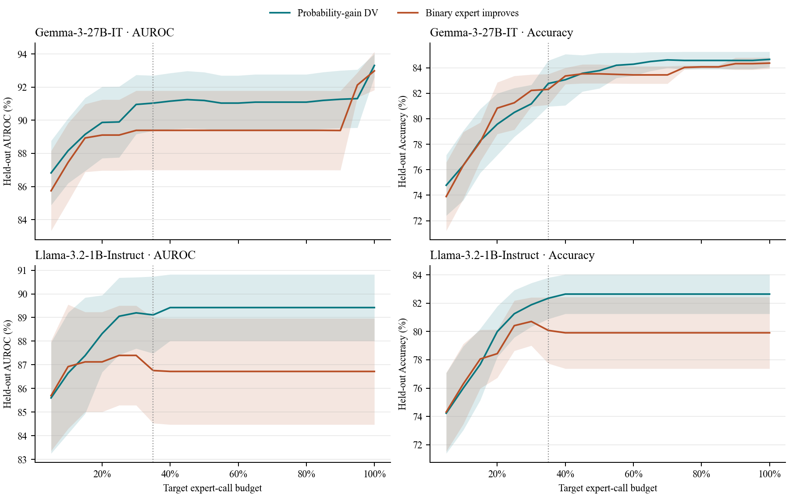

# Delegation value versus binary correction

Budget-control comparison of probability-gain delegation value (DV) and a binary target that predicts whether the expert corrects a probe error. Panels show held-out AUROC and accuracy for Gemma and Llama. Curves show means across three seeds; shaded bands show ± one standard deviation (divisor 3). LTT thresholds are selected separately for each metric. The dotted vertical line marks the 35% target expert-call budget.
